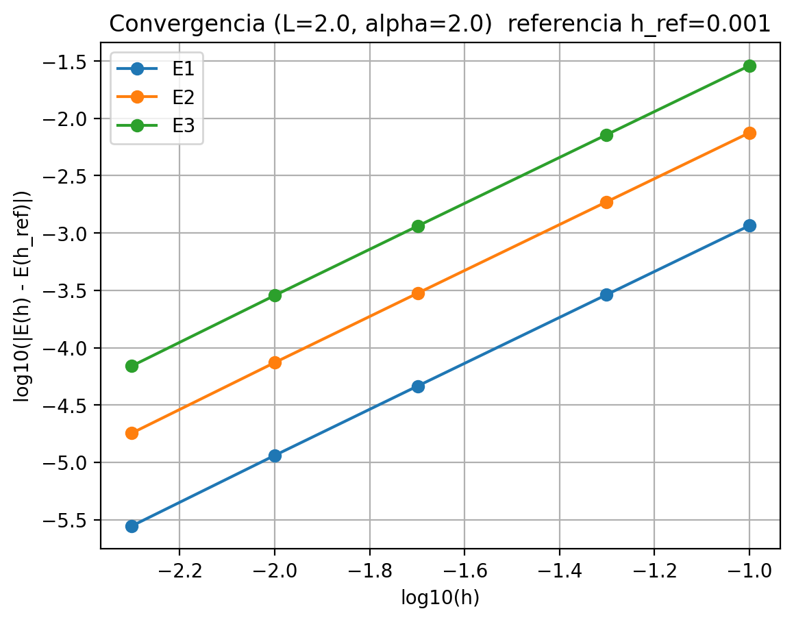
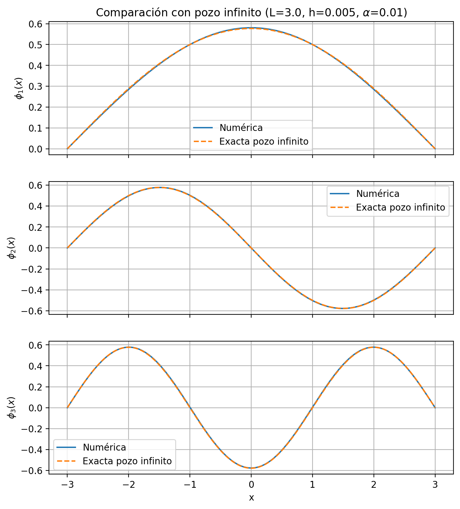

# Schrödinger eigenvalue solver: node counting and bisection

Solves the 1D time-independent Schrödinger equation

$$-\varphi''(x) + V(x)\,\varphi(x) = E\,\varphi(x), \qquad V(x) = \alpha x^2 \ \text{inside a box } [-L, L] \text{ with infinite walls,}$$

finding the energies by **Sturm node counting with bisection**. A three-point finite-difference recurrence counts the nodes of the solution at a trial energy, and bisection closes in on the energy where the node count jumps from n−1 to n. The eigenfunction is then integrated at the converged energy.

Written in Python (NumPy, Matplotlib) for the Modelling and Simulation course of the M.Sc. in Advanced Physics (Computational Physics), UNED.


*Error of the first three energies against a fine reference (h = 0.001) for L = 2, α = 2. The slope is about 2, as expected for a second-order scheme.*

## Validation

The solver is checked in three ways:

1. **Grid convergence:** second-order convergence in h towards a fine-grid reference (figure above).
2. **Wide box → free oscillator:** for large L the levels tend to the free values √α (2n − 1). For α = 2, L = 3, h = 0.001:

   | n | Numerical E_n | Free oscillator √α (2n − 1) |
   |---|---|---|
   | 1 | 1.414246 | 1.414214 |
   | 2 | 4.243387 | 4.242641 |
   | 3 | 7.078854 | 7.071068 |

   The small excess grows with n because higher states feel the walls more. For L = 2, the confinement raises the levels to 1.438, 4.468 and 8.026.
3. **Weak potential → infinite square well:** as α → 0, the eigenfunctions and energies tend to the exact infinite-well solution, sin(nπ(x + L)/2L) with E_n = (nπ/2L)².


*First three eigenfunctions for α = 0.01, L = 3 (solid) against the exact infinite-well solution (dashed).*

## Scripts

| File | What it does | Output |
|---|---|---|
| `potencial.py` | Core solver: potential, node counting, bisection energy search, eigenfunction integration | – |
| `main.py` | Grid-convergence study for L = 1, 2, 3 (α = 2): energies, sampled eigenfunctions, log–log convergence plots | `resultados_pozo_parabolico/` |
| `main_b.py` | Sweep over L, α and h, compared with the free-oscillator levels | CSV summary |
| `main_c.py` | Small-α limit compared with the exact infinite well (L = 3) | `apartado_c_L3_pozo_infinito/` |
| `plot_autofunciones.py` | Plots eigenfunctions from the CSV outputs | figures |
| `writer.py` | CSV helpers | – |

## Usage

```bash
pip install -r requirements.txt
python main.py      # convergence study
python main_b.py    # sweep in L, alpha, h
python main_c.py    # infinite-well limit (a few minutes)
```

Code comments and plot labels are in Spanish.
